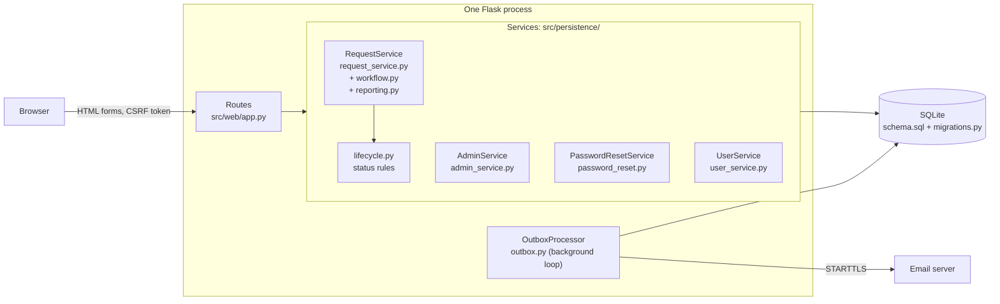
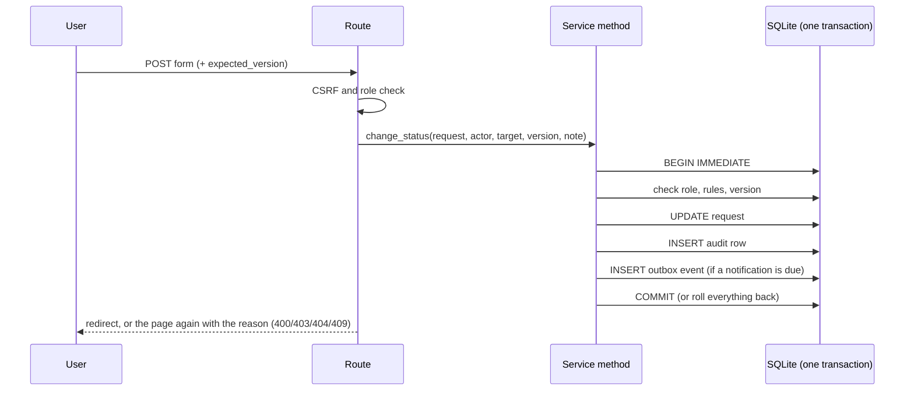
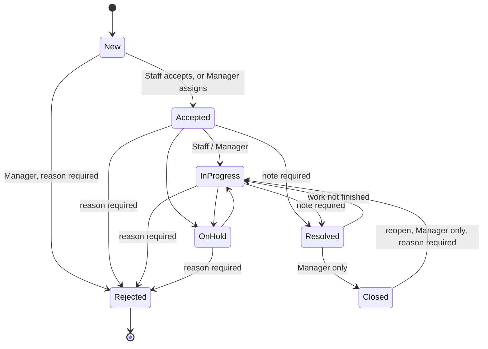
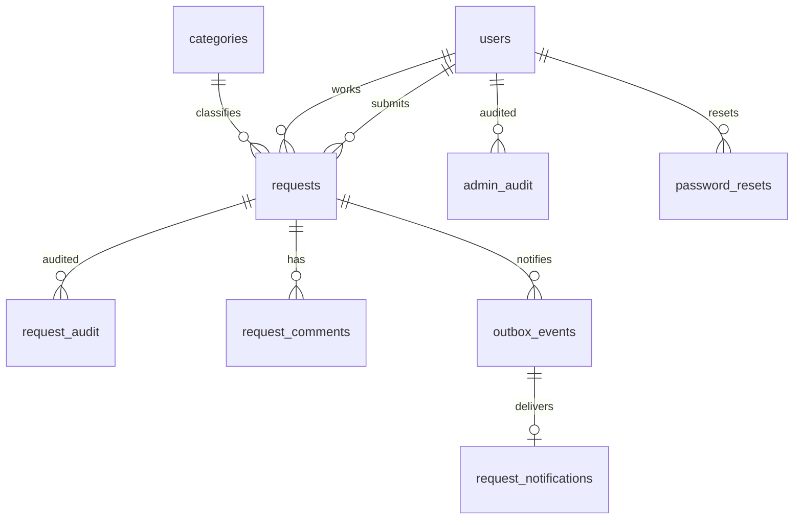

# Architecture

**One sentence:** a browser talks to one Flask application, which asks small service classes to do the
work inside database transactions; SQLite is the only store; a background loop sends email.

Why this shape: the project must cost R0 and be easy to run and defend, so there is one deployable unit,
no separate front end, and no external services. The options considered and scored are in
[ADR-001](decisions/adr/ADR-001-architecture-and-stack-options.md); hosting is still an open decision
([DEC-008 recommendation](decisions/DEC-008-recommendation.md), still a proposal).

## 1. The layers

| Layer | File | Responsibility | Does not |
|---|---|---|---|
| Routes | `src/web/app.py` | Read the form, check sign-in, CSRF and role, call one service method, render a template | Contain business rules or SQL for changes |
| Rules | `src/persistence/lifecycle.py` | The status table and who may make each change | Touch the database |
| Workflow | `workflow.py` | Status changes, assign and reassign, comments: each one transaction | Decide what a page looks like |
| Reporting | `reporting.py` | One validated query behind every list, the dashboard, overdue, CSV, duplicate check | Write anything |
| Administration | `admin_service.py` | Accounts, roles, categories (Administrator only), with audit | |
| Reset | `password_reset.py` | Single-use expiring links, stored as hashes | |
| Accounts | `user_service.py` | Registration and the shared password rules | |
| Notifications | `outbox.py` | Turn queued events into in-app messages and emails | Run inside a request |
| Schema | `schema.sql`, `migrations.py` | The tables; numbered upgrades applied when a service starts | |

Every service re-checks the caller's role itself. The routes check too, but a missing route check cannot
expose data.

## 2. How a change travels (the pattern used everywhere)

- **Atomic:** the change, its audit row and its notification commit together or not at all.
- **Safe against stale pages:** every change carries the version it was based on; a mismatch returns 409 and writes nothing.
- **Audit is tamper-resistant:** `request_audit` and `admin_audit` reject UPDATE, DELETE and replacement through the application
  connection (database triggers). Someone who owns the database file could still drop the triggers.
- **A notification cannot be lost by a failed request:** the event is stored in the same transaction, and a background loop sends it
  and records the outcome. Delivery is at-least-once: a crash in the middle of sending can leave an event stuck or repeat an email
  (a known limit, see the [release summary](release/m3-release-evidence-summary.md)).

## 3. The request lifecycle

The table lives in one place, `lifecycle.TRANSITIONS`. The rules beyond what FR-014 to FR-018 state are a
**proposal** awaiting a team decision: [DEC-019](decisions/DEC-019-lifecycle-transition-table.md).

## 4. The data

| Table | Holds | Notes |
|---|---|---|
| `users` | email, bcrypt hash, one role, active flag | roles: Requester, Staff, Manager, Administrator |
| `categories` | name, target hours, active flag | the target drives "overdue" |
| `requests` | the request, status, assignee, resolution note, rejection reason, `version` | `version` is the stale-page guard |
| `request_audit` | actor, UTC time, previous and new status and assignee | append-only |
| `request_comments` | author, text, time | not an audit entry |
| `outbox_events`, `request_notifications` | queued and delivered notifications | event stored in the same transaction as the change |
| `admin_audit` | account, role and category changes | append-only |
| `password_resets` | token **hash**, expiry, used time | single use |
| `schema_migrations` | which upgrades have run | see `migrations.py` |

## 5. Security model in five lines

1. Sign-in uses bcrypt (cost 10 to 16); sessions are HttpOnly, SameSite=Lax cookies; every form carries a CSRF token.
2. Each request re-reads the user, so a deactivated account stops working immediately.
3. A role can never see more than its scope: Requesters only their own, Staff unassigned plus their own, Managers all;
   Requester contact details are shown only to the assigned Staff user, Managers and Administrators.
4. Every user value reaches SQL as a bound parameter; sort columns come from a fixed map.
5. Secrets are environment variables only; reset tokens and passwords are never stored in readable form.

## 6. Where to change what

| To change... | Edit |
|---|---|
| Who may move a request where | `lifecycle.py` (then `tests/test_m4_workflow.py`) |
| A page's wording or layout | `src/web/templates/`, `src/web/static/style.css` (then run `python -m scripts.check_layout_overflow`) |
| A list's filters or sorting | `reporting.py` (`parse_filters`, `search_requests`) and `_filters.html` |
| The database shape | add a numbered migration in `migrations.py`; never edit an applied one |
| An email's wording | `outbox.py` (`build_message`) |
| A setting | an environment variable; see the table in the README |

## 7. What is deliberately not here

No separate front end, no message broker, no external identity service, no second database. Hosting and the
production database are open ([decision log](decisions/decision-log.csv): DEC-008, Deferred). Known gaps: login and
reset rate limiting, revoking sessions after a password reset, durable hosted storage, external email delivery.
